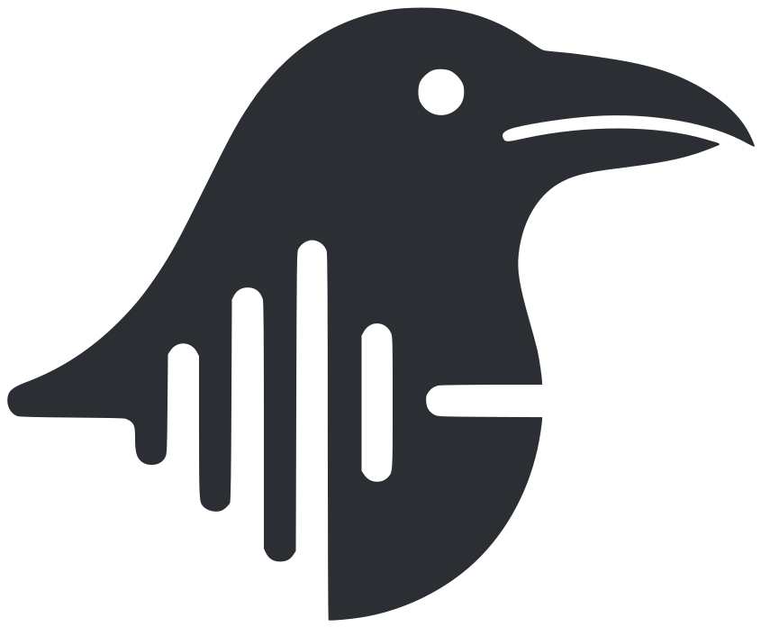
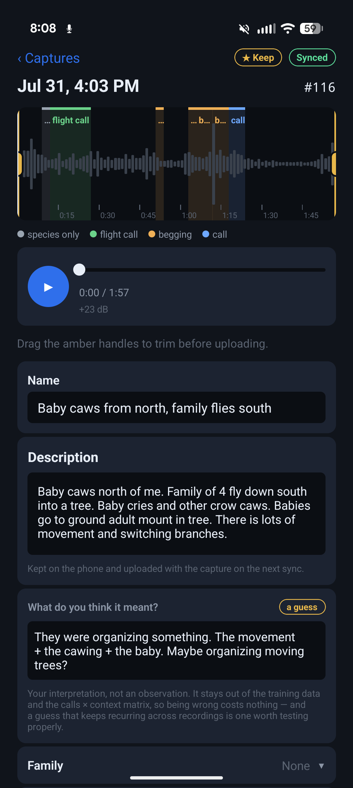
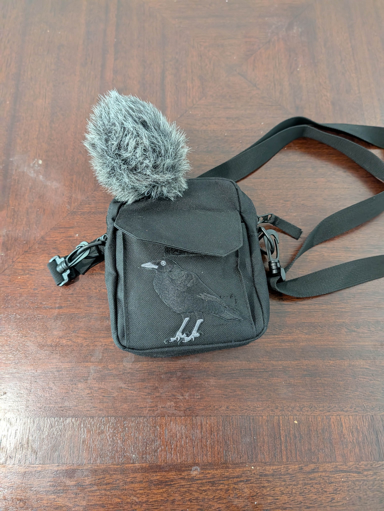

<p align="center">
  
</p>

<h1 align="center">CrowGPT</h1>

<p align="center"><strong>An AI to talk to crows.</strong><br>
A classifier that reads crow calls by type, a model that says them back, and a field kit for collecting what the calls were about.</p>

<p align="center">
  <a href="https://cawtalker.org">Website</a> ·
  <a href="https://cawtalker.org#crowgpt">Hear it</a> ·
  <a href="#quick-start">Quick start</a> ·
  <a href="#how-cawdex-works">How it works</a> ·
  <a href="#where-it-is-today">Where it is today</a> ·
  <a href="#collaborate">Collaborate</a>
</p>

<p align="center">
  
  
  
  
</p>

---

This started when I began feeding a murder of local crows. They were obviously smart, obviously talking to each other, and I wanted to know what about. CrowGPT is the set of tools that came out of it:

- **CawDex** reads crow calls. Audio goes in, every corvid call comes out found, named by species, and labeled by type on a timeline.
- **CrowGPT**, the model, says them back. An 18M-parameter transformer trained from scratch on crow call bouts, with no human labeling in the loop. Ask it for an alarm call and it produces one.
- **The field app and CawScout** collect the missing half: what was actually happening when a crow called, written down at the moment it happened. That is the ingredient that turns a call type into a meaning.

The end state is a translator that runs in both directions. Simple calls first: dog spotted, person arriving, food going down. Nobody is decoding crow grammar here.

| | | | |
|:---:|:---:|:---:|:---:|
| **5** | **0.97** | **4** | **7.3 min** |
| corvid species with their own call-type head | alarm-call AUC on clean labels, recording-grouped | call types CrowGPT can be asked for | human-labeled call audio, the number that limits the project |

## Hear it

Two generations of the model next to a real field-recorded alarm call, so you can judge the gap yourself: **[cawtalker.org#crowgpt](https://cawtalker.org#crowgpt)**. Everything under a CrowGPT caption is generated, not a recording of a bird.

Two things about it matter more than the audio. It does not copy its training set: what it produces is generated, not retrieved ([experiment 0015](experiments/0015-is-it-copying-or-playing-it-safe/)). And it beat a 433M pretrained audio model fine-tuned on the same corpus ([experiment 0022](experiments/0022-does-a-pretrained-audio-model-help/)), which says the corpus and the training setup are doing real work.

There is no quality percentage here on purpose. The obvious score, asking BirdNET whether it hears a corvid, is circular: BirdNET also selected the training corpus, so the model has been trained indirectly to please the judge. It scores above real audio, which is not plausible as realism and is how the problem was caught. The honest tiebreaker is a listening test, and no number goes here until one is run.

## Quick start

You need Python 3.10, [uv](https://docs.astral.sh/uv/), Node 22, `ffmpeg` and `make`. Everything runs locally; nothing phones home.

```bash
git clone https://github.com/benfaerber/crowgpt.git
cd crowgpt

# The BirdNET environment the analyzer and the worker run in
python3.10 -m venv pipelines/representation/.venv-birdnet
pipelines/representation/.venv-birdnet/bin/pip install \
  birdnetlib==0.18.1 tflite-runtime==2.14.0 "numpy<2" scikit-learn joblib librosa

make analyzer     # loads BirdNET and lists the five trained heads
make field        # field server + inference worker -> http://127.0.0.1:5100
```

Open the dashboard, sign in with the operator token it prints, and drag any audio or video file onto it. It uploads through the same endpoints the phone uses, the worker analyzes it, and the calls come back typed on a waveform. The trained heads ship in `pipelines/training/models/`, so this works on a fresh clone with no corpus.

<p align="center">
  
  &nbsp;&nbsp;
  
</p>

**Generate a crow call.** `crowgpt/` has its own environment, several GB, carrying torch and birdnetlib together. Training needs the corpus under `data/`, which is not in the repo (see [the corpus](#the-corpus)).

```bash
make -C crowgpt venv        # one-off
make -C crowgpt extract     # corpus -> call bouts
make -C crowgpt tokenize    # bouts -> codec tokens
make -C crowgpt train       # ~10 min on a 4070 Ti SUPER
make -C crowgpt demo        # results/demo.html
```

**Add a species.** The crawler fetches recordings from Xeno-canto or the Macaulay Library, and one command trains the head. The analyzer picks it up on the next start.

```bash
make -C corvidcrawler venv
cp corvidcrawler/.env.example corvidcrawler/.env     # add XENOCANTO_KEY (free)
make -C corvidcrawler crawl SP=monedula GEN=Coloeus SLUG=eurasian-jackdaw
make train SLUG=eurasian-jackdaw
```

**Put the app on a phone.** Android, built with Expo. Needs the Android SDK and a JDK 17+ on your path, as [mobile/README.md](mobile/README.md) describes.

```bash
make install-app   # standalone build, keeps captures already on the phone
make test          # every suite, no device needed
```

Set `FIELD_LAT` and `FIELD_LON` in `fieldserver/.env` before analyzing browser uploads. They turn on BirdNET's species-occurrence filter for captures without GPS of their own. Without it the global model will happily name a Rook in Utah, and since Rook has a trained head, the wrong species gets a confident call type hung off it. Phone captures carry their own coordinates and ignore this.

## How CawDex works

Raw audio is too high-dimensional to classify directly, so every clip becomes a fixed-length fingerprint first.

1. **Detect.** [BirdNET](https://birdnet.cornell.edu/) finds the corvids in any audio or video file and names the species, with a timeline of where the calls sit.
2. **Embed.** Each clip becomes a BirdNET embedding, where acoustically similar calls land near each other. Classical MFCC features and a general audio transformer both sat near chance. A bird-specific model was the unlock.
3. **Pool.** Mean, standard deviation and max across the clip's three-second segments (`pipelines/training/pooling.py`), so the feature captures temporal spread, the signature of a repeated, insistent alarm versus a single call.
4. **Classify.** A small logistic-regression head per species maps the fingerprint to a call type. At a few hundred examples per species, a regularized linear model beats a deep net.

Each detection is routed to its own species' model. A corvid the detector can find but nobody has trained is shown species-only, never mislabeled with another species' head. Five species have heads today: American Crow, Carrion Crow, Common Raven, Rook, Hooded Crow.

### The five call types

CawDex sorts every call into one of five classes, the same five the app offers a recordist. Finer field labels fold into them, so a mobbing crow is filed as alarm and a rattle as call.

| Call type | How it sounds | What it says | Also filed here | How well it reads today |
|---|---|---|---|---|
| **Alarm call** | Harsh, fast, repeated, with the whole bird in it | Something is wrong, and the other crows are being told | mobbing, scold: the directed, persistent version aimed at a cat, an owl or a hawk | 0.97 AUC on clean labels |
| **Flight call** | Spaced, carrying caws given on the wing | Keeps the group in touch while it moves | | 0.91 AUC, even on archive labels |
| **Call** | Unhurried, spaced out, back and forth between birds | Nothing is happening; the ordinary talk between crows that know each other | contact call, rattle: the dry, knocking run given close to another bird | The largest and vaguest class |
| **Begging** | A rasping, nasal, repeated *caah*, flatter than an adult's, and it goes on and on | A fledgling asking to be fed; a family group is nearby | | BirdNET's weak spot: it scores a begging fledgling at 0.06, so these mostly arrive by hand |
| **Song** | Quiet, odd, rambling, often to itself | Nobody knows yet; likely the most information of all | | 0.91 AUC on clean labels, 0.56 on archive tags |

**Scope is loud calls only.** Crows also make quiet soft song that likely carries more information, but it needs a close mic and drowns in noise. Broadcast calls are stereotyped, repeated and high-SNR, which is what weak supervision needs.

## The result that matters

Two call classes stayed stubbornly weak when trained on the archives' coarse free-text tags. Trained instead on hand-reviewed labels, 3,162 one-second segments somebody sat and listened to, the same pipeline, unchanged, lifts them decisively. Recording-grouped cross-validation, so nothing is graded on data it trained on.

| Class | Archive weak labels | Clean labels |
|-------|:---:|:---:|
| alarm call | ~0.65 | **0.97** |
| song | ~0.56 | **0.91** |

So alarm and song were label-limited, not unlearnable. The bottleneck was never the algorithm, which is exactly why the rest of this project is a data-collection system rather than more machine learning. Write-ups: [`pipelines/representation/results/report.md`](pipelines/representation/results/report.md) and [`pipelines/ingest/`](pipelines/ingest/).

## Two problems hide in one question

Inside the listening half there is a split, and keeping it straight is the main design decision in the project.

1. **What are the call types?** Are the categories acoustically separable at all? A plain classification problem on audio, and the answer is yes, given labels good enough to learn from. **Solved.** Everything below this line is engineering.
2. **What does each type mean?** Mapping a call to "I see a dog" needs that call paired with witnessed context, written down at the moment it happened. No quantity of audio alone gets there. **Open.** This is the frontier.

## The field kit

Building a labeled set by hand does not scale, so the collection is its own system: record corvid audio in the field with GPS, get it analyzed, and say what was heard and what was happening. Heavy model work never sits in the request path.

- **The app** is Android and local-first. It records unprocessed 48 kHz audio and video, keeps the last fifteen seconds in memory so pressing Record captures what you already heard, and uploads only when asked. An interrupted upload is the normal case, so every step is resumable and safe to repeat.
- **The analysis** runs in the background, off the recording device. The server and the worker share one SQLite file and nothing else, so inference takes as long as it takes and the fleet never waits on it.
- **The labeling desk** is where the work happens. Calls get confirmed, corrected, or marked by ear, and each one tagged with what was going on at the time.
- **CawScout** says where to point the microphone: a 250 m grid over the whole valley, scored on canopy height from satellite, parks and turf from OpenStreetMap, community crow sightings, and a penalty for nest predators, ranked into a numbered target list on the app's map.

Three kinds of ground truth come back, deliberately kept apart:

- **Labels** are what the bird said: a span plus a call type from a closed vocabulary. The only thing that feeds training.
- **Context** is what a human saw while that call was made. It attaches to the call, not the recording: tag the whole capture and a clip where a dog walks through and the crow later sings would report that crows sing at dogs.
- **Observations** are free text written afterwards, to explain a confusing prediction and to find which situations recur often enough to earn a tag.

A call can be marked **by ear**, with no detection behind it. That matters more than it sounds: a system that only lets you confirm detections can only ever collect what the model already finds, and the classes it is worst at could never gain a single training example.

The seed of the semantics set is one family, the Poe family: two parents, two fledglings and a yearling helper, recorded in the same backyard day after day. A call heard from the same bird twenty times means far more than twenty calls from twenty strangers.

## Where it is today

The state of play, plainly. Every limit here is a piece of work waiting.

- **Human labeling is early.** At last count, 66 labels across 16 captures, plus 158 context events. Measured as call audio rather than label count, that is about 7.3 minutes, the number that actually limits this project.
- **Detected calls are guesses.** Only human labels are ground truth, and until recently there were none at all.
- **No call has been translated.** The classifier says *alarm call*; it does not say *dog*. Nothing here has yet mapped a call to a meaning, because that needs enough calls paired with a witnessed situation, and I am still collecting the first few dozen.
- **Public uploads are not open yet.** The app and the pipeline are mine alone for now. There is no TLS and one shared enrollment secret, fine on a home network and blocking for anything public.
- **Most of the corpus is not crows I met.** It is seeded archive clips and test uploads, with the genuine field recordings marked by a ★ Keep flag. Any count that does not filter on that describes the pipeline, not crows, and the dashboard says which it is showing.

Known gaps, in rough order of how much they would hurt: full-precision GPS on every capture (a public dataset would need coarsening first); retracting a synced label while offline leaves it on the server; re-cropping a capture after upload does not re-send the audio.

## Everything is measured

`experiments/` holds 92 numbered folders, each a `run.py` and a `README.md` that ends with what the answer changed: a threshold, a purchase, a decision not to build something. The nulls are recorded alongside the wins, because "would a denoiser help" answered properly and then forgotten is the kind of question that gets asked three times. The corpus is gitignored, so the numbers are the durable part.

## Repository layout

| Path | What it is |
|------|------------|
| [`analyzer/`](analyzer/) | BirdNET inference: species and call types from a recording. No server, no database. |
| [`pipelines/representation/`](pipelines/representation/) | Which embedder separates call types: classical vs AST vs BirdNET |
| [`pipelines/training/`](pipelines/training/) | Pooling and the per-species call-type heads |
| [`pipelines/ingest/`](pipelines/ingest/) | The vendored American Crow label corpus and the per-species training pipeline |
| [`crowgpt/`](crowgpt/) | Generating crow calls: a small transformer over codec tokens |
| [`corvidcrawler/`](corvidcrawler/) | The corpus crawler: Xeno-canto and the Macaulay Library into `data/` |
| [`fieldserver/`](fieldserver/) | Fleet ingest and command-and-control API, plus the inference worker |
| [`dashboard/`](dashboard/) | Operator dashboard (Vite + React), served by the field server |
| [`mobile/`](mobile/) | The field capture app (React Native + Expo, Android first) |
| [`promo/`](promo/) | The public site, a compiled static bundle |
| [`experiments/`](experiments/) | 92 numbered measurements, each with what the answer changed |
| [`phases/`](phases/) | The phased plan and dated results |
| `data/` | The corpus. Gitignored, never committed. |

## Data and attribution

### crow-tools, which is why the classifier works at all

**[crow-tools](https://github.com/CrowCall/crow-tools)**, MIT, © OpenShot Studios / owlmaddie, deserves more than a line in a list, because the single biggest result in this project is not ours. Trained on the archives' weak tags, alarm call sat at ~0.65 AUC and song at ~0.56. Trained on crow-tools' labels they reach 0.97 and 0.91. That difference came entirely from 3,162 hand-reviewed segments across 1,549 recordings, somebody sitting and listening to several thousand seconds of crow, one second at a time. None of it was our labour.

Its label vocabulary shaped ours. The core classes here are a deliberate mapping of crow-tools' flags, and where we departed from it we measured first and wrote down why ([experiment 0012](experiments/0012-are-the-crow-tools-subclasses-learnable/)). The upstream project is no longer maintained, so the labels are vendored at [`pipelines/ingest/crowtools/labels.json`](pipelines/ingest/crowtools/) and the audio is re-fetched from the archives it came from. They remain crow-tools' work under its MIT licence.

### The corpus

The recordings are fetched by [`corvidcrawler/`](corvidcrawler/) from Xeno-canto and the Macaulay Library and held locally for research, each with its recordist so attribution is possible. The audio, its database and every field recording live under `data/`, which is gitignored and not part of this repo.

## Collaborate

If you have crows, a phone and a few minutes a day, you can collect the half this project is short of. Recordings with a witnessed situation attached are worth more than anything else here. A species with no head yet needs a few hundred typed examples, and the crawler plus `make train` does the rest.

Write to **hello@cawtalker.org**, or open an issue.

## License

A licence has not been chosen yet. Until it is, the code is all rights reserved, with the exceptions noted above.
